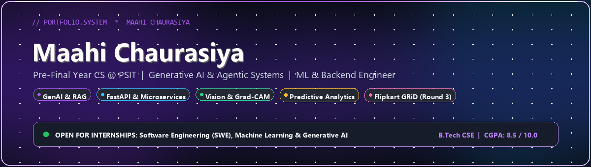

<!-- Hero Banner -->

  

<!-- Dynamic Animated Subtitle -->

  
  &nbsp;
  
  &nbsp;
  
  &nbsp;
  

---

### 👨‍💻 About Me

> **Computer Science undergraduate at PSIT Kanpur** *(B.Tech, Graduating May 2028 | **CGPA: 8.5 / 10.0**)*.
> Focused on building **FastAPI backends** with **Streamlit dashboards** using **LLMs, RAG, and Computer Vision**, backed by **Pytest** test suites and solid Core CS fundamentals (DSA, OOP, DBMS, OS).

- 🎯 **Target Roles:** Software Engineering (SWE), Machine Learning, Generative AI Internships.
- 🏆 **Achievements:** Flipkart GRiD Semi-finalist (Round 3) • Adobe Hackathon Participant • 149+ LeetCode Solved.

---

### 🚀 Projects

<table>
  <tr>
    <!-- Project 1: RetryIQ -->
    <td width="33.3%" valign="top">
      

        <h3>🛡️ <a href="https://github.com/Maahichaurasiya/RetryIQ">RetryIQ</a></h3>
        
<strong>AI Payment Recovery System</strong>

      

      <ul>
        <li><strong>LLM Classification:</strong> Evaluates payment failure causes with rule-based checks deciding <code>RETRY/BLOCK</code> via FastAPI.</li>
        <li><strong>Reliability:</strong> 5+ mechanisms including HMAC webhooks, idempotency, scheduled retries, retry limits, and event logging.</li>
        <li><strong>Observability & Tests:</strong> Real-time Streamlit dashboard + Pytest suites for failure scenarios and retry rules.</li>
      </ul>
      

        <strong>Tech Stack:</strong> 
        <code>FastAPI</code> • <code>LLM</code> • <code>SQLAlchemy</code> • <code>Streamlit</code> • <code>Pytest</code>
      

      

        <a href="https://github.com/Maahichaurasiya/RetryIQ"><strong>View Repository →</strong></a>
      

    </td>
    <!-- Project 2: CuraVision AI -->
    <td width="33.3%" valign="top">
      

        <h3>🩺 <a href="https://github.com/Maahichaurasiya/CuraVision-AI">CuraVision AI</a></h3>
        
<strong>Health Diagnosis Assistant</strong>

      

      <ul>
        <li><strong>Decoupled Endpoints:</strong> Separate FastAPI microservices for NLP and vision, connected via a Streamlit UI.</li>
        <li><strong>LLM + RAG:</strong> Prescription tool referencing clinical guidelines in <strong>ChromaDB</strong>.</li>
        <li><strong>Vision Diagnostic:</strong> Fine-tuned <strong>EfficientNet</strong> on HAM10000 skin lesions + <strong>Grad-CAM</strong> heatmaps for interpretability.</li>
      </ul>
      

        <strong>Tech Stack:</strong> 
        <code>FastAPI</code> • <code>RAG</code> • <code>ChromaDB</code> • <code>EfficientNet</code> • <code>Grad-CAM</code>
      

      

        <a href="https://github.com/Maahichaurasiya/CuraVision-AI"><strong>View Repository →</strong></a>
      

    </td>
    <!-- Project 3: CreditWise -->
    <td width="33.3%" valign="top">
      

        <h3>💳 <a href="https://github.com/Maahichaurasiya/CreditWise-Loan-Approval-System">CreditWise</a></h3>
        
<strong>Loan Credit Risk Prediction</strong>

      

      <ul>
        <li><strong>High Accuracy:</strong> Default classifier on 600+ records achieving <strong>87.5% accuracy</strong>, <strong>79% precision</strong>, <strong>80.3% recall</strong>.</li>
        <li><strong>Feature Engineering:</strong> Custom debt-to-income and asset leverage ratios, imputation, and standard scaling.</li>
        <li><strong>Analytics UI:</strong> Streamlit dashboard tracking risk indicators and metrics.</li>
      </ul>
      

        <strong>Tech Stack:</strong> 
        <code>Scikit-learn</code> • <code>Pandas</code> • <code>NumPy</code> • <code>Streamlit</code>
      

      

        <a href="https://github.com/Maahichaurasiya/CreditWise-Loan-Approval-System"><strong>View Repository →</strong></a>
      

    </td>
  </tr>
</table>

---

### 🛠️ Technical Skills

- **Languages & Core CS:** Data Structures & Algorithms, OOP, DBMS, OS, Python, C++, SQL (MySQL)
- **Backend & Engineering:** FastAPI, REST APIs, SQLAlchemy, SQLite, Webhooks, Git, GitHub, Pytest, Unit Testing
- **Machine Learning & AI:** Scikit-learn, Pandas, NumPy, Deep Learning, Computer Vision, NLP
- **Generative & Agentic AI:** LLM Integration, RAG, ChromaDB, Agentic AI (Exploring)
- **Data & Visualization:** Streamlit, Matplotlib, Seaborn, Jupyter Notebook, Exploratory Data Analysis

---

### 💼 Experience & Certifications

- **🏢 Deloitte — Data Analytics Job Simulation (Forage | May 2026):** Forensic data analysis in Excel, Tableau visualization dashboard, and executive recommendations.
- **📜 Certifications:** AI/ML Course (Apna College) • Python Programming (Infosys Springboard)
- **🏆 Hackathons:** Flipkart GRiD (Round 3 Semi-finalist) • Adobe Hackathon (Participant)

---

### 🧩 Algorithmic Problem Solving & Activity

&nbsp;

  

&nbsp;

&nbsp;

